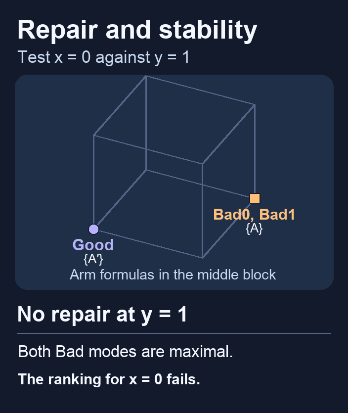

# The complexity of strongly stable source tripartition existence

  

Given propositional sources, deciding whether any three-level reliability ranking is recovered by every one of its own preferred merges is Σ₃ᴾ-complete. Hardness holds for disjoint sources of at most three individually satisfiable formulas.

[Read the paper](paper/manuscript.pdf) · [LaTeX source](paper/manuscript.tex) · [Proof outline](proof/PROBLEM_AND_PROOF.md) · [Run the replay](REPRODUCIBILITY.md)

## One repair must exist for every challenge

In the example a proposed ranking pins x. For the challenge y = 1, x = 0 leaves two destabilizing Bad outcomes. With x = 1, the choice z = 1 enables Repair. It keeps A and adds C in the middle priority class, so both Bad modes lose. With x = 1 the y = 0 challenge also has a repair, and the ranking is strongly stable.

[Download the offline explorer](https://raw.githubusercontent.com/DannyExperiments/strongly-stable-tripartition-existence/refs/tags/v1.0.0/visualization/repair-stability-explorer.zip), extract it, and open index.html. Choose x and y and rotate the Boolean arm-label cube. [Figure guide](visualization/README.md)

## Source and companion

This answers Liberatore's existence question in §8.6. The skeptical-consequence companion applies the same base reduction and separately studies querying its maximal consistent subsets. [Original paper](https://www.jair.org/index.php/jair/article/download/11238/26438#page=51) · [Pinned Q621](https://github.com/10m-u/open-problems-catalog/blob/ca8d4d44ba3db527f19f28928c240168f545ecfe/problems/computer_science_ai/theory-of-computation-algorithms-part-1.md#q621) · [Q622 companion](https://doi.org/10.5281/zenodo.24572374)

[Mathematical audit](audits/public_safe_reports/MATHEMATICAL_AUDIT.md) · [Literature audit](audits/public_safe_reports/LITERATURE_AUDIT.md) · [Scope](CLAIM_SCOPE_AND_LIMITATIONS.md) · [AI disclosure](AI_DISCLOSURE.md) · [Status](STATUS.md)

[Release v1.0.0](https://github.com/DannyExperiments/strongly-stable-tripartition-existence/releases/tag/v1.0.0) · [Version DOI](https://doi.org/10.5281/zenodo.24572371) · [Citation](CITATION.cff)
